# DEAD ZONE: OUTBREAK
**ITU CS-464 Lab 07: Mobile game menu system in Unity**
**Name:** Muhammad Abu Bakar | **Roll number:** BSCS25109

A zombie-survival mobile game menu system with **10 connected, working screens**. Inspired by *The Walking Zombie 2* (mobile). No colours, art or assets were copied; the visual identity is original.

- **Demo video:** TODO paste your video link
- **Windows build (download and play):** TODO paste your GitHub Release link

## Screen flow
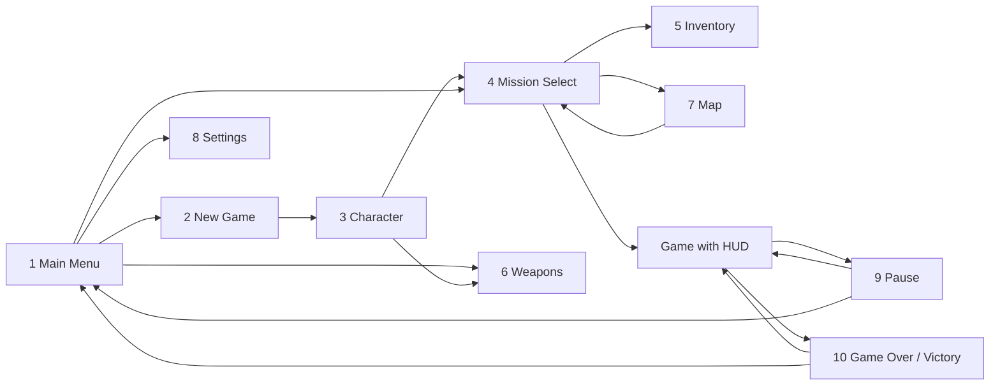
Every screen has a **< Back** button in the same bottom-left position (Escape also goes back in the menus). Pause and Game Over can both return to the Main Menu, so there are no dead ends.

## Visual identity and palette
Original palette, built on a **complementary harmony**: blue-teal (hue about 0.56) against amber (hue about 0.11). Split roughly 60 / 30 / 10: Midnight, Steel and Amber.

| Role | Name | Hex | Used for |
|---|---|---|---|
| Background | Midnight | `#182B36` | Screen background |
| Panels, buttons | Steel | `#344C59` | Panels, normal buttons |
| Accent | Amber | `#E8B75A` | Primary actions, titles, selected states |
| Text | Ivory | `#F3F0E8` | Main text |
| Secondary text | Mist | `#A9BAC2` | Labels, hints |
| Positive | Teal | `#4FB3A5` | Success, healthy state |
| Danger | Alert | `#EE7D75` | Damage, warnings, defeat |
| Panel (pause/over) | Panel | `#2A3F4B` | Pause and Game Over panels |
| Lighter button | Selected | `#4A6878` | Filled slots, pause buttons |

**Contrast (WCAG ratio):** Ivory on Midnight 12.8, Ivory on Steel 7.9, Amber on Midnight 7.9, Mist on Midnight 7.3, Alert on Midnight 5.4, Teal on Midnight 5.8. The first Alert (`#C85C55`) was only 2.2 on Steel, so it was lightened to `#EE7D75`.

**Greyscale values** (Rec.709 luminance, as GIMP "Luminance"): Deep 26, Midnight 40, Panel 59, Steel 72, Selected 99, Alert 148, Teal 157, Mist 183, Amber 187, Ivory 240.

**Design rules from the greyscale check**
- **Amber (187) and Mist (183) merge in grey.** They never carry meaning side by side alone: size, position and labels separate them.
- **Alert (148) and Teal (157) merge in grey.** Danger and good are never shown by these two alone: always with a word and a shape (`YOU DIED` / `SURVIVED!`, `X` / `OK`, `HP 100/100`).
- A selected state always has more than one cue (frame, size, lighter fill or a word).
- Disabled states always have a word and a shape (`LOCKED` + padlock, `EMPTY`).

## Technical notes
- **Layout:** Canvas Scaler 1080x1920 (match 0.5), stretch and corner anchors, a safe-area script, large touch targets (130 px and up).
- **Navigation:** one `MenuNavigator` with a back stack; the game scene uses one `GameUI` state machine (Playing / Paused / Over).
- **Motion:** our own `Tween.cs` and `Ease` functions (OutCubic, OutQuad, InCubic, InOutQuad, OutBack). Tweens run on **unscaled time**, so they work while the game is paused. **No imported animations** (no Animator controllers, no `.anim` clips).
- **Assets:** only Unity built-in primitives, built-in UI sprites and the default TextMeshPro font. 3D previews (character and weapons) are built from cubes, spheres, capsules and cylinders and shown through Render Textures.

---
# Screens

## 1. Main Menu
**Purpose:** The hub of the game: one obvious primary action (PLAY), everything else is secondary.

**Principles and techniques**
- Colour theory: 60-30-10 split (Midnight / Steel / Amber) with a complementary accent
- Visual hierarchy: title in Amber, PLAY larger and brighter than the Steel buttons
- Grouping and spacing: equal 160 px spacing between buttons, buttons in the thumb zone (Fitts's law)
- Responsive layout: anchors, Canvas Scaler 1080x1920, safe area
- Feedback: every button has a press state (darker tint + scale)

**Tweens / ease curves**

| Element | Property | Time | Ease | Why |
|---|---|---|---|---|
| Title and subtitle on first launch | alpha + Y slide 60 px | 0.45 s | OutCubic | Fast start, soft landing: the brand reads first |
| Buttons on first launch | alpha + Y rise 80 px, 0.07 s stagger | 0.35 s | OutCubic | Stagger order shows reading order (PLAY first) |
| Screen change (all screens) | alpha + X slide 120 px | 0.30 s | OutCubic | Forward comes from the right, Back from the left |
| Every button press | scale 1 to 0.94 to 1 | 0.08 s / 0.18 s | OutQuad / OutBack | Instant tap confirmation, small spring for affordance |

| Colour (annotated) | Greyscale |
|---|---|
| 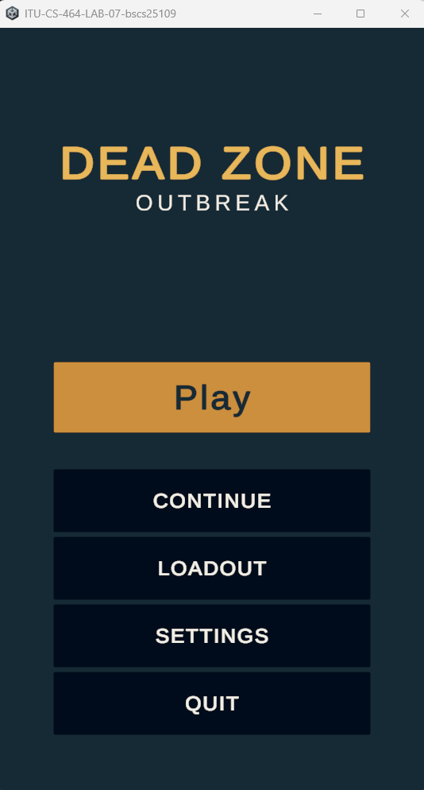 | 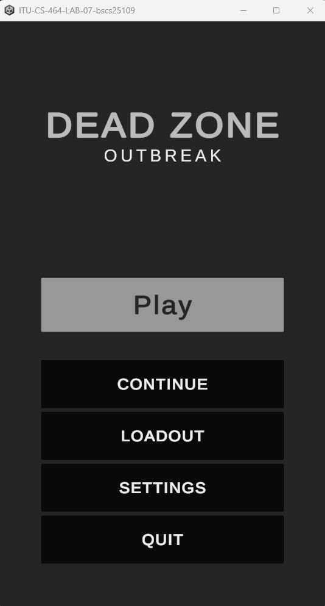 |

**Greyscale result:** No change needed. The `DEAD ZONE` title, bright `Play` primary button, and darker secondary buttons (`CONTINUE`, `LOADOUT`, `SETTINGS`, `QUIT`) maintain strong luminance separation and clear reading order in greyscale.

## 2. New Game
**Purpose:** Name the survivor and choose a difficulty before continuing.

**Principles and techniques**
- Common region: the form sits in one panel
- Alignment and proximity: labels share one left edge and sit next to their fields
- Affordance: the text field looks like a box; the selected difficulty is Amber and larger
- Redundant cues: difficulty is written as a word, not only colour
- Consistency: same Back position and button style on every screen

**Tweens / ease curves**

| Element | Property | Time | Ease | Why |
|---|---|---|---|---|
| Whole screen | alpha + X slide | 0.30 s | OutCubic | Forward direction cue |
| Form panel then CONTINUE | alpha + Y rise 50 px, 0.12 s apart | 0.35 s | OutCubic | Form arrives first, action second: reading order |
| Selected difficulty toggle | scale 1 to 1.08 | 0.20 s | OutBack | Small overshoot says: this one is chosen |
| Buttons | press scale | 0.08 s / 0.18 s | OutQuad / OutBack | Tap confirmation |

| Colour (annotated) | Greyscale |
|---|---|
| 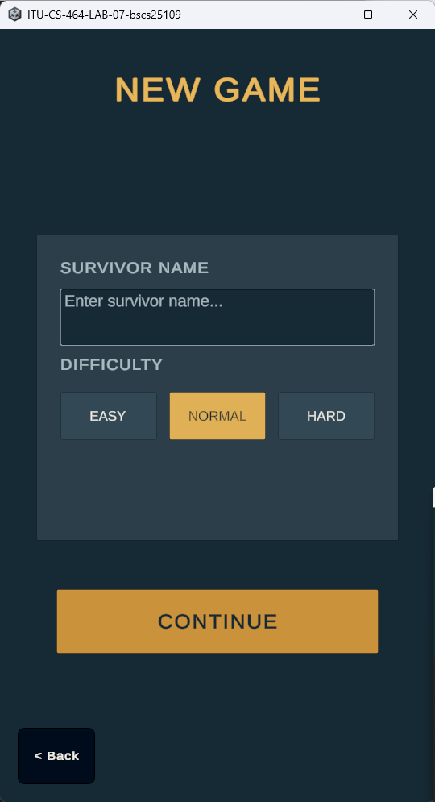 | 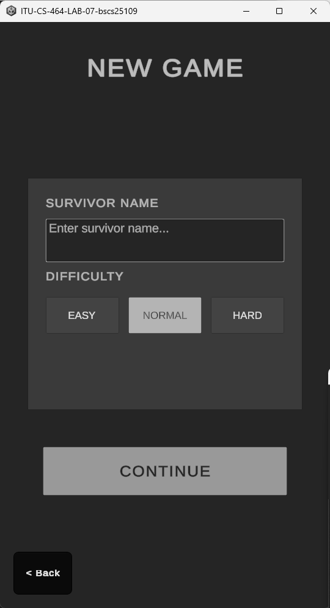 |

**Greyscale result:** No change needed. The selected `NORMAL` difficulty stands out cleanly by brightness against `EASY` and `HARD`, the text input border remains distinct, and `CONTINUE` stays the clearest call to action.

## 3. Character
**Purpose:** Show the survivor (built from Unity primitives) and its basic stats.

**Principles and techniques**
- Hierarchy: the 3D preview is the focus, then name, stats, buttons
- Common region and alignment: all stats in one panel, labels left, values right
- Redundant cues: each stat has a label, a number and a bar
- Colour value: Amber numbers stand out against the Steel panel
- 3D inside UI: a second camera renders the primitive character into a Render Texture shown in a Raw Image

**Tweens / ease curves**

| Element | Property | Time | Ease | Why |
|---|---|---|---|---|
| Whole screen | alpha + X slide | 0.30 s | OutCubic | Forward/back cue |
| Stat rows | alpha + Y rise 30 px, 0.12 s apart | 0.25 s | OutCubic | Rows appear top to bottom in reading order |
| Stat bars and numbers | fill 0 to value and count-up | 0.60 s | OutCubic | Bar and number share the same curve so they always agree |
| Buttons | press scale | 0.08 s / 0.18 s | OutQuad / OutBack | Tap confirmation |

| Colour (annotated) | Greyscale |
|---|---|
| 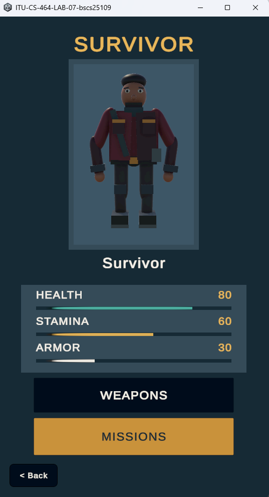 | 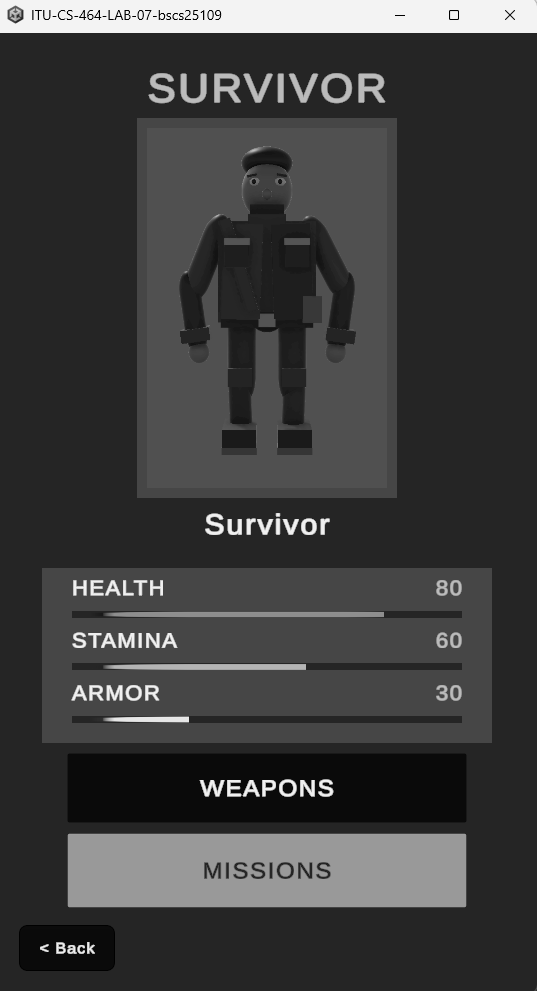 |

**Greyscale result:** No change needed. Although the Teal `HEALTH` bar and Amber `STAMINA` bar sit close in greyscale luminance, every stat remains immediately readable through its text label, numeric value (`80`, `60`, `30`), and bar length; `MISSIONS` stays clearly separated from `WEAPONS`.

## 4. Mission Select
**Purpose:** Choose a mission and start the game; also the hub to Map and Bag.

**Principles and techniques**
- Similarity: all cards share one shape and size
- Grouping: a layout group gives equal spacing; Map and Bag form a secondary pair
- Hierarchy: the selected card is brightest, START MISSION is the biggest button
- Redundant cues: difficulty words; locked = word + padlock; selected = frame + size + lighter fill
- Fitts's law: START is large and in the thumb zone; Scroll View allows more missions

**Tweens / ease curves**

| Element | Property | Time | Ease | Why |
|---|---|---|---|---|
| Whole screen | alpha + X slide | 0.30 s | OutCubic | Forward/back cue |
| Mission cards on open | alpha only, 0.08 s apart | 0.25 s | OutQuad | List builds in reading order (alpha only because a Layout Group controls position) |
| Selected card | scale 1 to 1.04 | 0.20 s | OutBack | Chosen card grows slightly: selection without relying on colour only |
| Buttons | press scale | 0.08 s / 0.18 s | OutQuad / OutBack | Tap confirmation |

| Colour (annotated) | Greyscale |
|---|---|
| 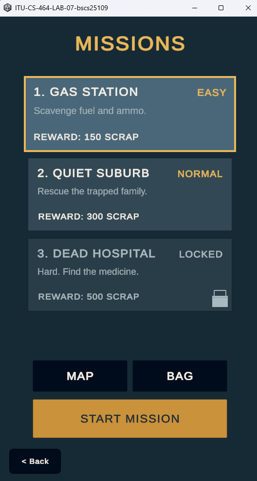 | 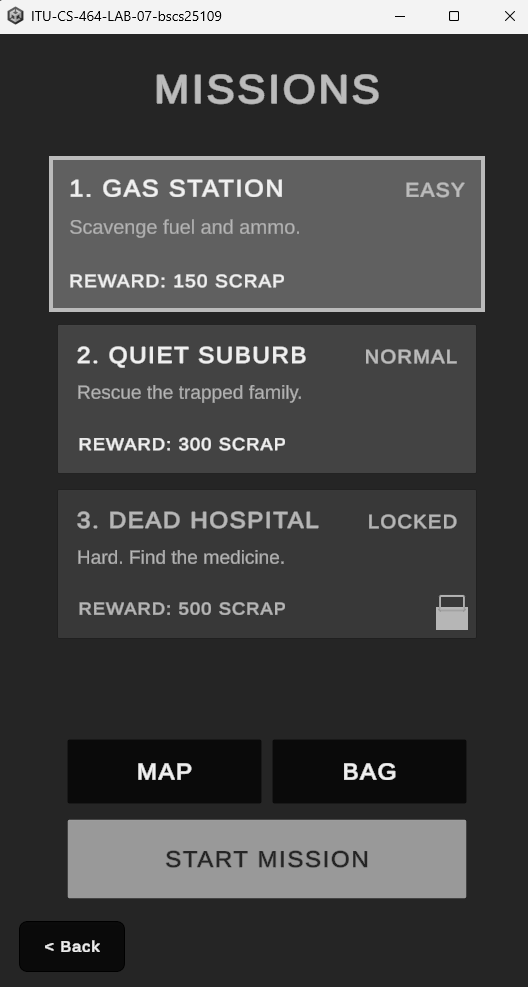 |

**Greyscale result:** No change needed. The selected card (`1. GAS STATION`) is clearly marked by both its bright border and lighter fill, the locked card (`3. DEAD HOSPITAL`) relies on the `LOCKED` label and padlock icon, and `START MISSION` clearly dominates over `MAP` and `BAG`.

## 5. Inventory
**Purpose:** Show collected items in a grid with a detail area and a Use action.

**Principles and techniques**
- Common region and similarity: one grid panel, identical 210 px slots
- Three clear levels: empty (darkest), filled, selected (gold frame)
- Redundant cues: icon + name + count; USE becomes EMPTY and grey when none left
- Proximity: label and count live inside each slot
- Touch targets: slots 210 px, USE 150 px high

**Tweens / ease curves**

| Element | Property | Time | Ease | Why |
|---|---|---|---|---|
| Whole screen | alpha + X slide | 0.30 s | OutCubic | Forward/back cue |
| Selected slot | scale 1 to 1.08 | 0.18 s | OutBack | Shows which item the detail panel is about |
| Detail text | alpha 0 to 1 | 0.15 s | OutQuad | Short fade shows the text changed |
| Count number after USE | punch scale 1 to 1.3 to 1 | 0.25 s | sine pulse | Draws attention to the value that changed |

| Colour (annotated) | Greyscale |
|---|---|
| 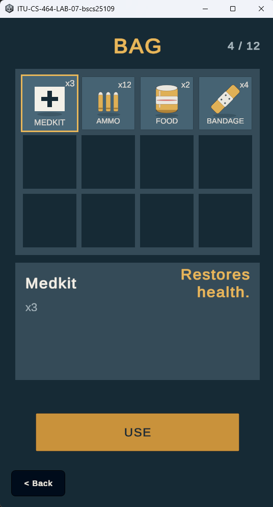 | 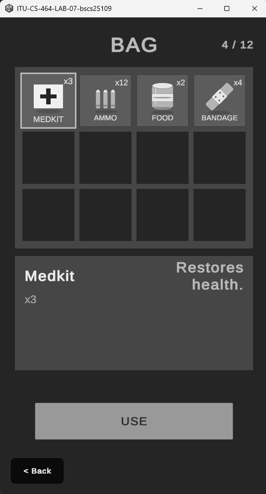 |

**Greyscale result:** No change needed. The three slot states—empty (darkest), filled (mid-grey), and selected (`MEDKIT` with bright border)—remain cleanly separated in greyscale, and every item is identified by its icon, label, and count.

## 6. Weapons
**Purpose:** Choose the starting weapon and compare its stats.

**Principles and techniques**
- Hierarchy: large 3D preview first, then tabs, stats, EQUIP
- Contrast: selected tab is Amber with dark text, the others Steel with Ivory text
- Redundant cues: every stat has a label, a bar and a number; the weapon name is written
- Feedback: label changes to EQUIPPED, model pops in
- Primitives only: every weapon is built from cubes and cylinders

**Tweens / ease curves**

| Element | Property | Time | Ease | Why |
|---|---|---|---|---|
| Whole screen | alpha + X slide | 0.30 s | OutCubic | Forward/back cue |
| New weapon model | scale 0.8 to 1 | 0.25 s | OutBack | The model arrives, so the change is noticed |
| Stat bars and numbers | glide from old to new value | 0.35 s | InOutQuad | A smooth glide lets the player compare two weapons |
| EQUIPPED label | punch scale | 0.25 s | sine pulse | Confirms the action completed |

| Colour (annotated) | Greyscale |
|---|---|
| 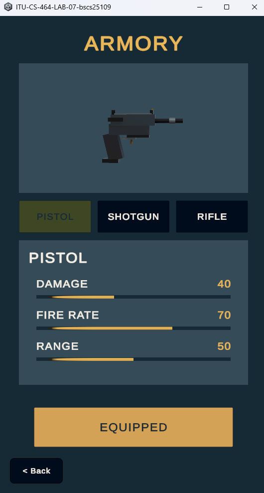 | 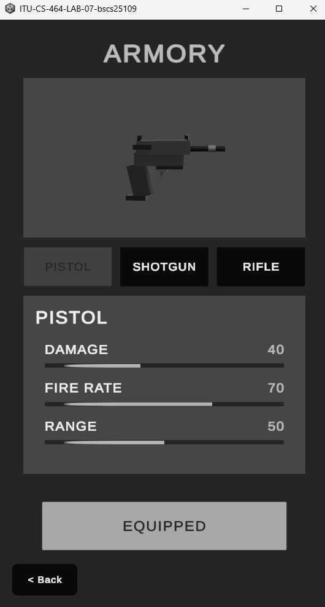 |

**Greyscale result:** Contrast issue spotted on the selected weapon tab (`PISTOL`): its darkened olive/amber fill drops to mid-dark grey behind dark text, giving lower contrast than `SHOTGUN` and `RIFLE` (white text on dark fill). The 3D preview, stat bars/numbers (`40`, `70`, `50`), and `EQUIPPED` button remain clear; brightening the active tab fill to full Amber (`#E8B75A`) resolves the tab contrast.

## 7. Map
**Purpose:** Show the survival area and which mission is selected.

**Principles and techniques**
- Common region: the map sits in one panel
- Redundant cues: markers have numbers and a legend; zones have text labels
- Selected marker is larger as well as brighter
- Anchors set to corners so the map scales correctly
- Large touch areas for the markers

**Tweens / ease curves**

| Element | Property | Time | Ease | Why |
|---|---|---|---|---|
| Whole screen | alpha + X slide | 0.30 s | OutCubic | Forward/back cue |
| Markers on open | scale 0 to 1, 0.10 s apart | 0.30 s | OutBack | Markers pop in mission order (1, 2, 3) |
| Selected marker | scale to 1.25 | 0.20 s | OutBack | Size, not only colour, marks the current mission |
| Mission info text | alpha 0 to 1 | 0.15 s | OutQuad | Shows the text changed with the tap |

| Colour (annotated) | Greyscale |
|---|---|
| 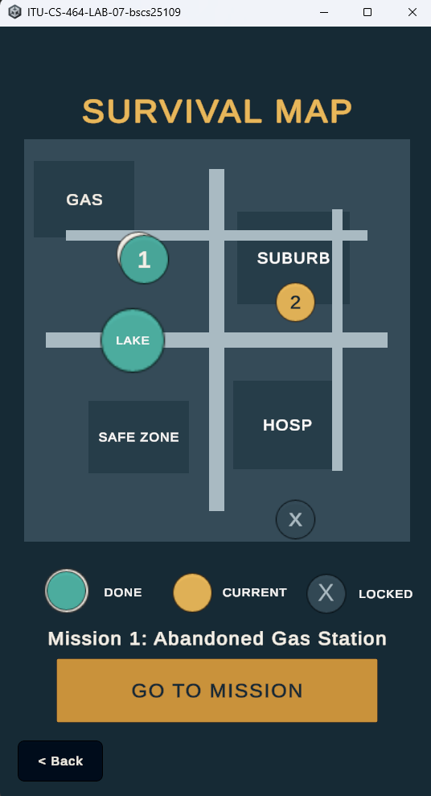 | 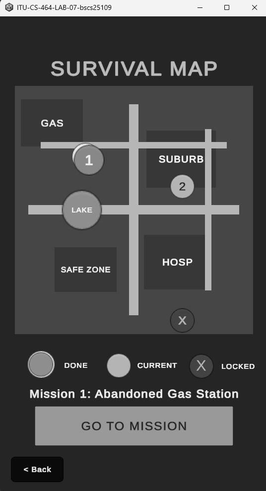 |

**Greyscale result:** No change needed. As expected from the palette luminance check, the `DONE` (Teal) and `CURRENT` (Amber) markers look close in greyscale tone, but the bright outer ring on `DONE`, mission numbers (`1`, `2`), `X` icon for `LOCKED`, text legend, and selected mission caption keep every state unambiguous.

## 8. Settings
**Purpose:** Audio, graphics quality and control hints.

**Principles and techniques**
- Grouping: three panels (Audio, Graphics, Controls) with titles
- Alignment: labels left, values and switches right
- Fitts's law: 80 px round slider handle, 140 x 70 switch, 120 px drop-down
- Redundant cues: volume as bar and number; music as colour, knob position and the word ON/OFF
- Contrast: dark knob on the gold ON track, light knob on the dark OFF track

**Tweens / ease curves**

| Element | Property | Time | Ease | Why |
|---|---|---|---|---|
| Whole screen | alpha + X slide | 0.30 s | OutCubic | Forward/back cue |
| Three panels | alpha + Y rise 40 px, 0.08 s apart | 0.30 s | OutCubic | The groups appear in order, so the grouping is visible |
| Music switch knob | X slide between two positions | 0.15 s | OutCubic | Short quick movement shows the state change |
| Volume slider on RESET | value glides to 0.8 | 0.30 s | InOutQuad | The player sees what Reset changed |
| Volume while dragging | none on purpose | - | - | The finger is the motion; extra animation would lag behind it |

| Colour (annotated) | Greyscale |
|---|---|
| 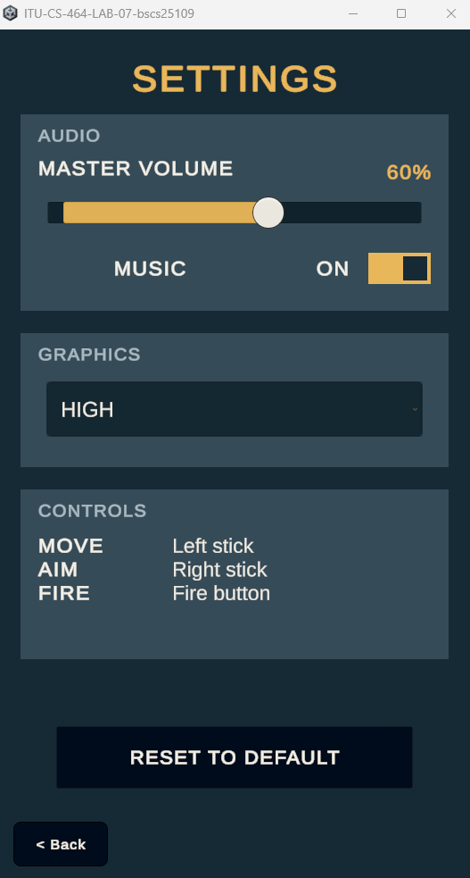 | 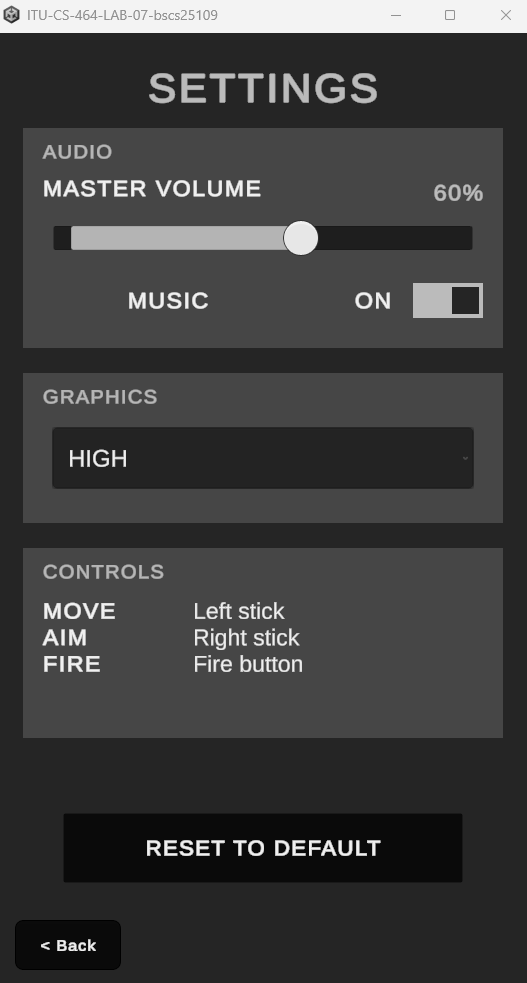 |

**Greyscale result:** No change needed. All three grouped panels (`AUDIO`, `GRAPHICS`, `CONTROLS`), the bright volume slider fill with white handle, the `ON` label paired with the right-aligned dark switch knob on a light track, and `RESET TO DEFAULT` stay crisp and legible in greyscale.

## 9. Pause
**Purpose:** Freeze the game and offer Resume, Restart and Quit to Menu.

**Principles and techniques**
- State machine: one script owns HUD, Pause and Game Over, so panels never fight
- Pausing with Time.timeScale = 0, input guarded, tweens on unscaled time
- Hierarchy: RESUME is gold and biggest; destructive action is last
- Focus: a stretch-anchored dim layer that blocks clicks, plus a bordered panel
- Redundant cues on the HUD: health colour gradient plus the text HP 100/100

**Tweens / ease curves**

| Element | Property | Time | Ease | Why |
|---|---|---|---|---|
| Dim background | alpha 0 to 1 | 0.20 s | OutQuad | Pushes the game into the background |
| Pause panel opening | scale 0.9 to 1 and alpha | 0.28 s | OutBack / OutQuad | Slight overshoot: the menu arrives in front of the game |
| Pause panel closing | scale to 0.95 and alpha to 0 | 0.15 s | InCubic | Closing is faster than opening so the player is never kept waiting |
| Health bar when hit | punch scale | 0.20 s | sine pulse | Shows damage where the eye checks most |
| Pale lag bar | slides down after 0.4 s | 0.8 per second | Linear | Shows how much one hit took |

| Colour (annotated) | Greyscale |
|---|---|
| 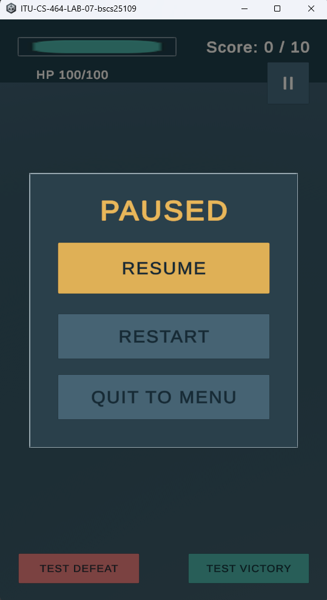 | 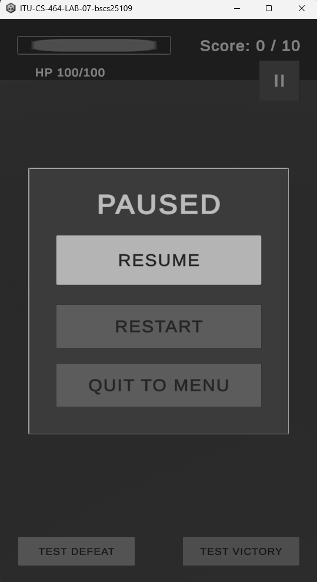 |

**Greyscale result:** No change needed. The bordered pause panel separates cleanly from the dimmed gameplay background, `RESUME` stands out as the brightest primary button above `RESTART` and `QUIT TO MENU`, and the HUD text (`HP 100/100`, `Score: 0 / 10`) stays legible.

## 10. Game Over / Victory
**Purpose:** Show the result (defeat or victory), the score, and offer Try Again or Main Menu.

**Principles and techniques**
- Colour meaning (red = danger, teal = good) plus word and shape (YOU DIED / SURVIVED!, X / OK badge)
- Hierarchy: title, badge, score, primary button
- Consistency: same panel and buttons as the Pause screen
- Restart resets Time.timeScale first; stretch dim blocks clicks
- Motion carries the mood: heavy sink for defeat, bounce for victory

**Tweens / ease curves**

| Element | Property | Time | Ease | Why |
|---|---|---|---|---|
| Dim and panel | alpha 0 to 1 | 0.30 s | OutQuad | Gently takes over from the game |
| Panel on victory | Y rises 150 px | 0.45 s | OutBack | Bounce = celebration |
| Panel on defeat | Y sinks 150 px | 0.60 s | InOutQuad | Slower, no bounce: serious mood |
| Title | scale 0.6 to 1 (after 0.25 s) | 0.40 s | OutBack | The most important text lands first |
| Score number | count 0 to score (after 0.35 s) | 0.80 s | OutCubic | Counting up lets the player feel the result |

| Defeat (colour, annotated) | Defeat (greyscale) |
|---|---|
| 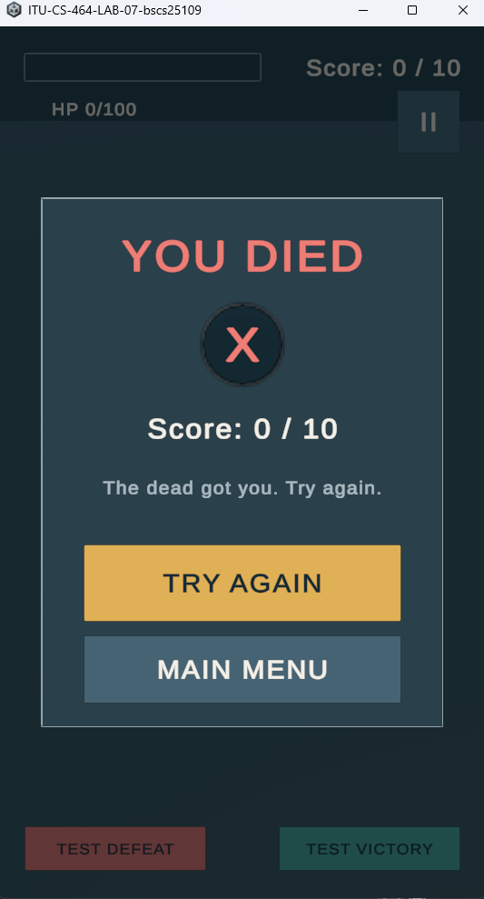 | 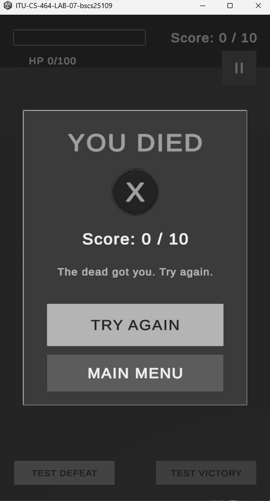 |

| Victory (colour, annotated) | Victory (greyscale) |
|---|---|
| 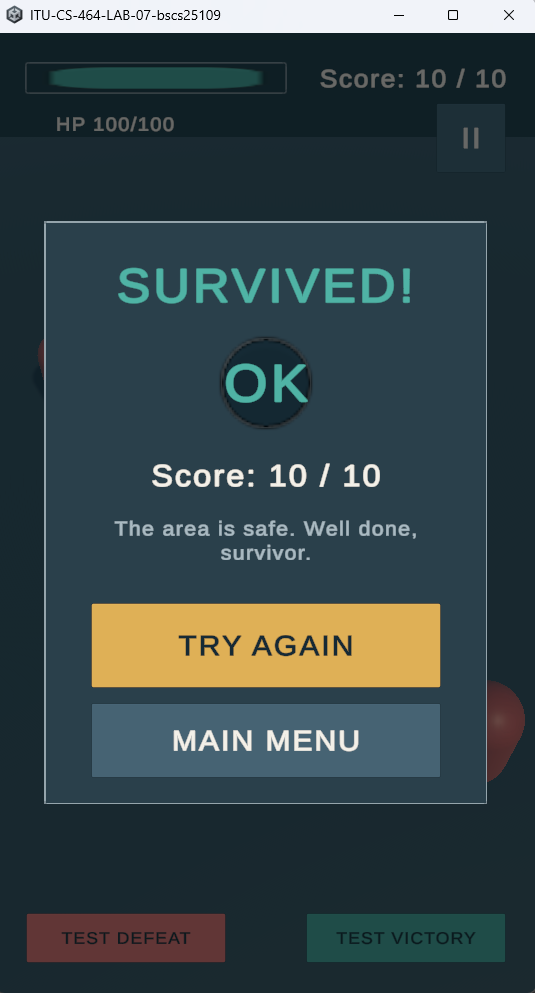 | 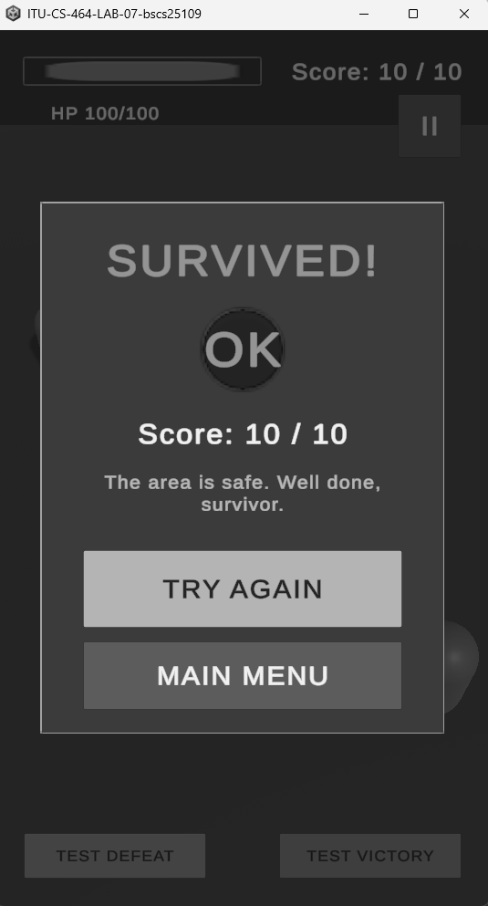 |

**Greyscale result:** No change needed. Although Alert red (`YOU DIED`) and Teal (`SURVIVED!`) merge to a very similar mid-grey luminance in greyscale, the distinct titles, `X` vs `OK` badges, feedback lines, and score values (`0 / 10` vs `10 / 10`) make both outcomes immediately distinguishable without colour.

---
# Credits and references
- **Course material:** CS464 Lecture 08, *Colour, UI Design and Menus* (colour theory, hierarchy, Canvas, pause and restart patterns).
- **Inspiration:** *The Walking Zombie 2* (mobile) for the zombie-survival theme only. No assets, art or colours were copied.
- **Unity:** built-in 3D primitives, built-in UI sprites (UISprite, Knob), TextMeshPro with the default Liberation Sans SDF font (SIL Open Font License).
- **Easing equations:** based on Robert Penner's easing functions (OutCubic, OutQuad, InCubic, InOutQuad, OutBack), written by hand in C#.
- **Contrast:** WCAG 2.x relative-luminance contrast ratio.
- **Greyscale:** Rec.709 luminance (GIMP: Colors > Desaturate > Luminance).
- **Third-party assets:** none. **AI-generated images:** none.