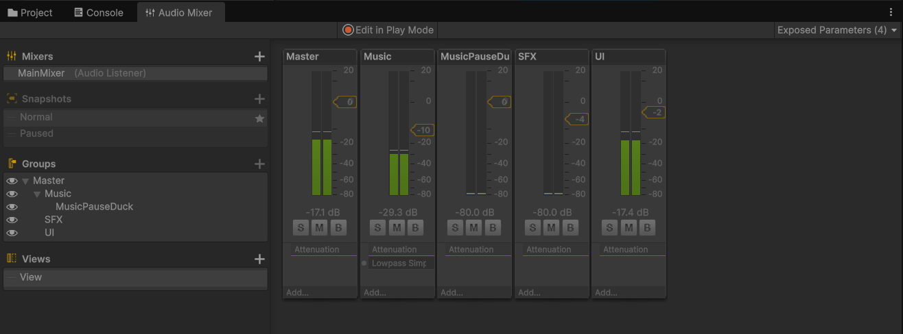

# DEAD ZONE: OUTBREAK — Lab 08

**Name:** Muhammad Abu Bakar | **Roll No:** BSCS25109 | **Course:** ITU CS-464 

Built directly on top of my Lab 07 10-screen UI project. All old menus, tweens, and responsive layouts still work. Lab 08 adds async scene loading, UI/gameplay audio, an Audio Mixer with saved settings, and C# events.

* **Demo Video:** [PASTE LINK HERE]
* **Windows Build:** https://github.com/bscs25109-ui/ITU-CS-464-LAB-08-bscs25109/releases/tag/v1.0



## Setup & Controls
1. In  Unity Hub (**Add > Add project from disk**).
2. Open `Assets/Scenes/MainMenu.unity` and press **Play** (Build order: `MainMenu`, `Loading`, `Game`).
3. **Controls:** `WASD` move, `Space` / **HIT** attack, `Esc` pause. Test keys: `H` (damage), `J` (heal), `K` (collect).

## Loading Flow
Clicking **START MISSION** or **TRY AGAIN** opens the `Loading` scene via `SceneLoader.Load("Game")`. `LoadingScreen` runs `LoadSceneAsync("Game")` with `allowSceneActivation = false` so the player can't enter early. Progress is calculated with `op.progress / 0.9f` for a real 0–100% bar, and the scene only activates after hitting 100% and playing the **READY** sound.

## Audio & Mixer (`MainMixer`)
* **Single Manager:** One `DontDestroyOnLoad` `AudioManager` (`Assets/Resources/AudioManager.prefab`) creates and routes all 8 `AudioSource` components in code—no button or gameplay object has its own `AudioSource`.
* **Groups:** `Master` -> `Music` (2 sources), `SFX` (4 pooled sources), `UI` (2 sources).
* **Exposed Params:** `MasterVolume`, `MusicVolume`, `SFXVolume`, `UIVolume`.
* **Snapshots:** `Normal` and `Paused` (Unscaled Time).
* **UI & SFX:** `UIButtonSoundInstaller` handles all button hover, click, back, open, success, and error sounds. `GameAudioListener` plays gameplay SFX (pickup, heal, damage, attack, death, win) with `PlayOneShot`, ±2 semitone random pitch, and slight volume variation.

## Volume Mapping & Saving
* Sliders range from `0.0001` to `1.0` and convert to dB via `Mathf.Log10(value) * 20f` (avoids linear scaling and `Log10(0)`).
* **Mute** sets `MasterVolume` to `-80 dB` while keeping slider values intact.
* All settings save to `PlayerPrefs` and restore automatically on restart.

## Music Transitions & Pause
Two looping Music sources handle equal-power crossfades (`cos` / `sin`) on unscaled time:
* **Menu -> Gameplay:** `GameManager.GameStarted`
* **Gameplay <-> Combat:** HP ≤ 40% (`Health.Damaged`) / HP > 60% (`Health.Healed`)
* **Win / Lose:** `GameManager.GameWon` / `GameLost`
* **Back to Menu:** `SceneMusic` on `MainMenu`

**While Paused:** Gameplay SFX pause (`AudioListener.pause = true`), Music stays on (`ignoreListenerPause = true`) but muffles via the `Paused` snapshot (Low-Pass 900 Hz, -8 dB), and UI sounds keep playing.

## C# Events
Gameplay scripts fire C# events instead of calling UI, audio, or VFX directly. All listeners use `+=` in `OnEnable`, `-=` in `OnDisable`, and publishers use `?.Invoke(...)`.

| Publisher | Event | Listeners |
|---|---|---|
| `Health` | `Damaged(cur, max)` | `HudListener`, `ShakeOnHit`, `GameAudioListener`, `ParticleFeedback`, `HitFlash` |
| `Health` | `Healed(cur, max)` | `HudListener`, `GameAudioListener`, `ParticleFeedback` |
| `Health` | `Died` | `GameManager`, `GameAudioListener` |
| `GameManager` | `GameStarted` | `HudListener`, `GameAudioListener` |
| `GameManager` | `Collected(score, target)` | `HudListener`, `GameAudioListener`, `ParticleFeedback` |
| `GameManager` | `GameWon` / `GameLost` | `GameUI`, `GameAudioListener` |
| `PlayerAttack` | `Attacked` | `GameAudioListener` |
| `GameUI` | `StateChanged(state)` | `PauseAudio` |

```csharp
// Publisher: Health.cs
public event Action<int, int> Damaged;

public void TakeDamage(int amount)
{
    if (current <= 0 || Time.time < invulnerableUntil) return;
    invulnerableUntil = Time.time + iFrames;
    current = Mathf.Max(0, current - amount);

    Damaged?.Invoke(current, max);
    GameEvents.RaisePlayerDamaged(current, max);
    if (current <= 0) Died?.Invoke();
}

// Subscriber: ShakeOnHit.cs
void OnEnable()  => health.Damaged += Shake;
void OnDisable() => health.Damaged -= Shake;

void Shake(int current, int max) => shake.AddTrauma(0.55f);
